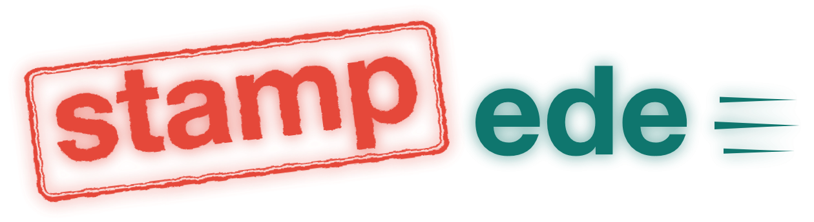
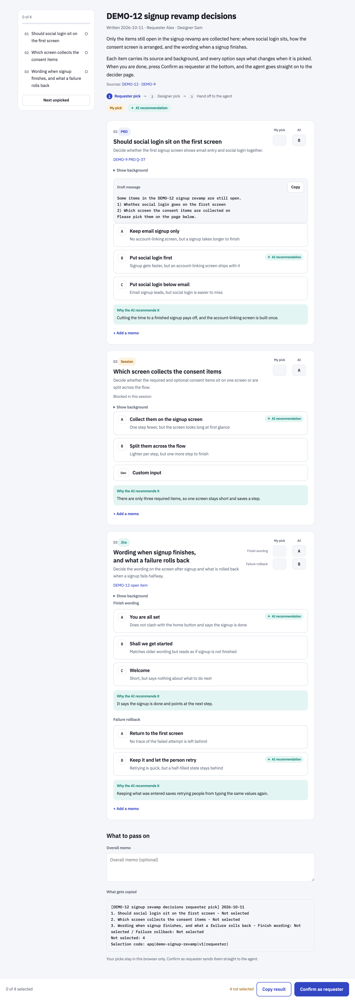
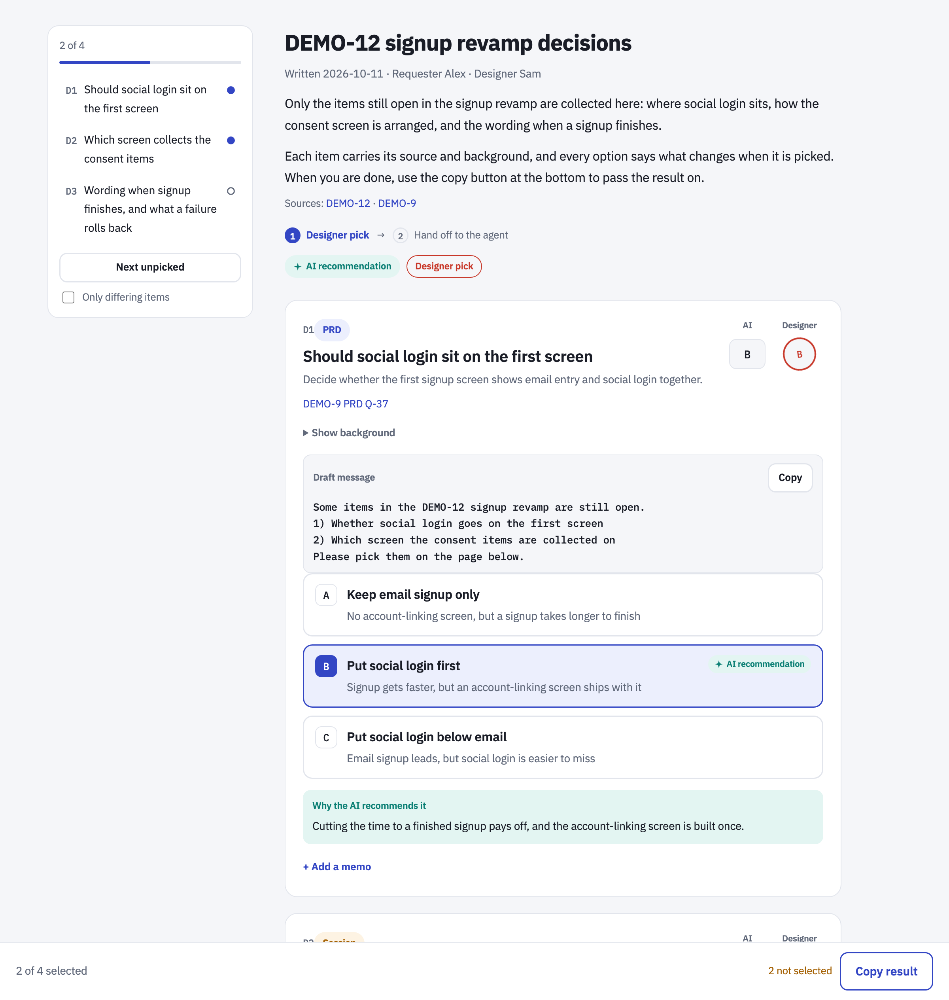
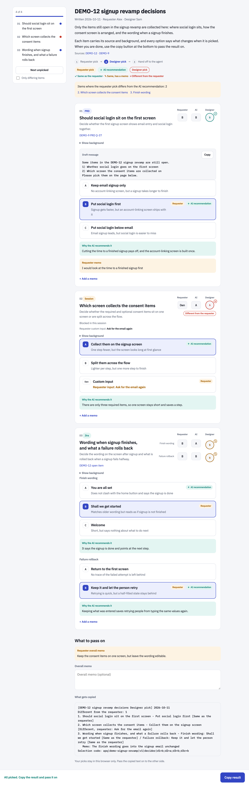
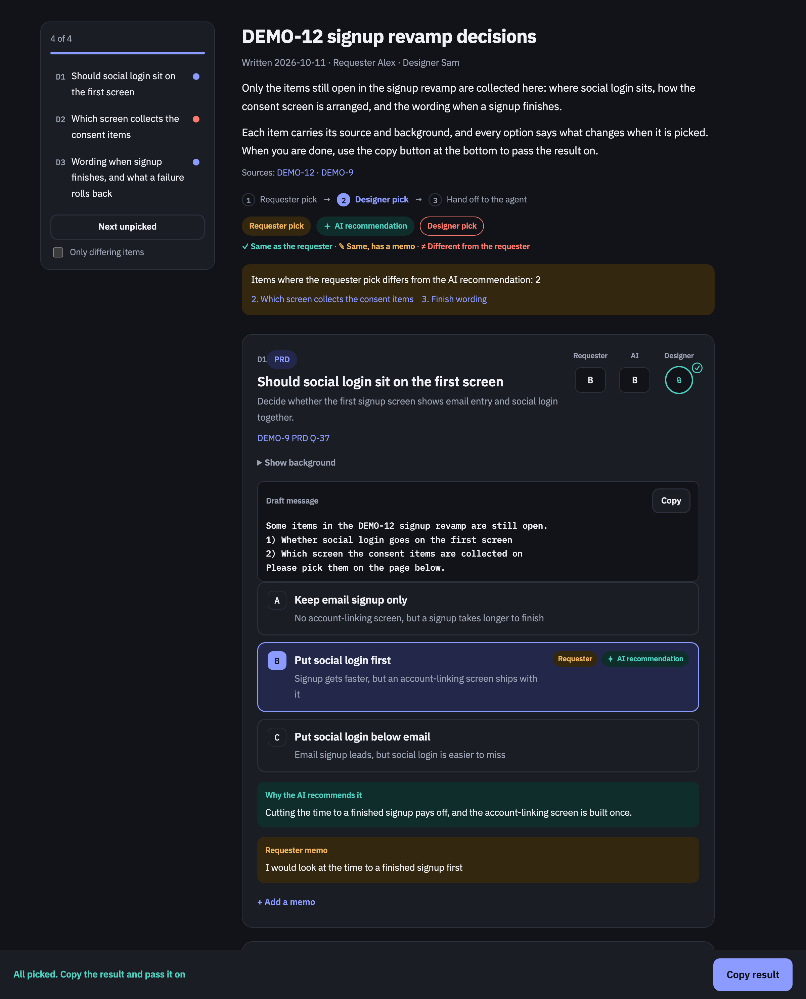

<h1 align="center"></h1>

<p align="center"><a href="README.md">한국어</a> · <b>English</b></p>

<p align="center"><b>pick + "pick me"</b>: When your work is blocked on someone else's call, hand them a one-page sheet where all they do is pick — a Claude Code skill</p>

<p align="center">
  <a href="https://github.com/lcalmsky/pickme/releases/latest"></a>
  <a href="LICENSE"></a>
  
  
</p>

<p align="center">
  <a href="#quick-start">Quick start</a> ·
  <a href="#features">Features</a> ·
  <a href="#installation">Installation</a> ·
  <a href="#usage">Usage</a> ·
  <a href="#publishing-channels">Publishing channels</a> ·
  <a href="#how-it-works">How it works</a>
</p>

Decisions you cannot make alone pile up. Screen work stalls while you wait for the person who owns the call, and asking them means rewriting the open items into a chat message. pickme turns those items into a single HTML page, takes the requester's and the decider's picks on that page, and returns the result with one copy.

- **The items and their evidence live on one page.** Each item carries its background, its options, what changes when each one is picked, and the AI recommendation with its reason. The decider can pick without reopening the source document.
- **Both rounds share one link.** The requester picks first and the decider makes the final pick over it. There is one page file and one data file, and only the data changes between rounds, so the URL does not.
- **The result comes back with one paste.** The text the page builds carries a selection code, so the agent parses it and fixes what was decided. The requester round opens on a local server, and its `Confirm as requester` button hands the reply straight to the agent.

<p align="center"></p>

## Quick start

Install the plugin in Claude Code.

```
/plugin marketplace add lcalmsky/pickme
/plugin install pickme@pickme
```

In the session that is blocked, run `/pickme:pickme`. Once you say who decides (role and name) and whether the requester picks first, the agent collects the open items and opens the requester page on a local server. Asking in plain words — "collect the questions for the designer" — works too.

Other ways to install are in [Installation](#installation).

## Features

| Feature | What it does |
|---|---|
| [Decision page](#the-decision-page) | Collects the open decisions as cards, each option with its effect and the AI recommendation with its reason |
| [Two rounds](#usage) | The requester picks first and the decider makes the final pick over it. The requester round can be skipped |
| [Local requester server](#the-requester-round-opens-locally) | Opens the requester page on 127.0.0.1 and hands the reply to the agent with its `Confirm as requester` button |
| [Publisher hook](#publishing-channels) | A shared host this repository does not know is added to the front of the chain with one executable file |
| [PIN lock](#the-pin-lock) | Locks the page published to a shared host behind a 4-digit PIN |
| [Korean and English pages](#language) | `meta.lang` picks the language of the screen text and the copied text |

### The decision page

Items come from three places: open questions in a spec or design doc (`prd`, `doc`), unresolved items on a ticket (`jira`), and blockers hit in this session (`session`). Each item carries its source and background, two to four options, an AI recommendation with a reason, and a custom-input box when the answer might not be on the list.

<p align="center"></p>

The approval cells at the top right of each card put the requester, the AI and the decider side by side. The decider's cell is marked `✓` when it matches the requester, `✎` when it matches but a memo was left, and `≠` when it differs, so the items that drifted stand out.

<p align="center"></p>

<p align="center"></p>

### Language

Set `meta.lang` to `ko` (the default) or `en` to fix the language of everything the page says and of the copied text. The lock screen and the locked page title follow the same language. Pick the language the decider reads.

## Installation

You need [Claude Code](https://code.claude.com) and `python3` (standard library only). The PIN lock also needs node (v26, built-in `webcrypto`) for `lock.mjs`.

| Way | Command |
|---|---|
| [Plugin](#install-as-a-plugin) (recommended) | `/pickme:pickme` |
| [Skill folder](#install-as-a-skill-folder) | `/pickme` |
| [Orca share link](#orca-install) | `/pickme` |

### Install as a plugin

```
/plugin marketplace add lcalmsky/pickme
/plugin install pickme@pickme
```

### Install as a skill folder

```bash
git clone https://github.com/lcalmsky/pickme.git
cp -r pickme/skills/pickme ~/.claude/skills/
```

### Update

| Install way | How to update |
|---|---|
| Plugin | Third-party marketplaces have auto-update off by default. Pick pickme in `/plugin` and press **Update now**, or run `claude plugin update pickme@pickme`. After updating, run `/reload-plugins` or start a new session |
| Skill folder | `git pull` in the clone and copy `skills/pickme` again |

<a id="orca-install"></a>

### Install from Orca

With [Orca](https://onorca.dev), open the [share link](https://share.onorca.dev/skills/share/shr_b4a59e552d35abfcd385bb171a41d15ad3b7b9071bea0166) and press `Open in Orca`. Orca shows the files it contains and lets you pick where to install them.

> [!NOTE]
> An Orca share link keeps the files it was published with, so it cannot be changed. The current link carries v0.1.0 and later releases are not in it. Install the latest with the plugin or skill folder way.

## Usage

Three steps. The agent collects the open decisions and writes the data, the requester picks first, the decider makes the final pick over it, and the result goes back to the agent.

| Step | What happens |
|---|---|
| 1. Requester | The page opens on a local server. Picking and pressing `Confirm as requester` hands the reply to the agent |
| 2. Decider | The same page is published to a shared host or as an Orca artifact. The decider picks and copies the result text back to the requester |
| 3. Agent | `render.py apply` parses the pasted text, fixes what was decided, and continues the work that was blocked |

When there is no requester round, put `skip_requester` in the data and publish the decider page directly. The decider's role is free: a PO, a designer, a developer, a QA — whoever owns the call. The role name goes on the screen as written, so use the wording the team uses.

### The requester round opens locally

The requester is the user on this machine, so that round does not go to a shared host. `serve.py` opens the page on 127.0.0.1 instead, and the page's `Confirm as requester` button sends the reply to that server. The server writes the reply to a file and exits, so nothing is copied or pasted. If the button is blocked, the `Copy result` button beside it still works as before.

## Publishing channels

The shared page is published through the user's own publishers first, then an Orca artifact, then a Claude artifact (a local file). A path this repository does not know — an internal share host, say — is added with one publisher file.

A publisher is an executable file in `${PICKME_PUBLISHERS_DIR:-$HOME/.config/pickme/publishers}`, tried in filename order. A missing or empty directory skips the whole step silently. Each publisher is called as:

```
<publisher> --name <name> --dir <state dir> --page <page.html> --locked-page <page-locked.html> --pin <NNNN>
```

The publisher decides whether to publish the locked or the unlocked page; a host that only the internal network can reach is fine unlocked. Success is exit code 0 with `delivered: <url>` as the last line of stdout, plus ` pin=NNNN` when the published page is PIN-locked. On failure, a last line of `skip: <reason>` is reported as it is. When a reason carries `(run: <command>)`, that command is a one-time step (a login, a VPN): the agent runs it, waits for the user's approval, and retries with `--start publisher:<file>`. Logins are never automated.

The channel a publisher reports is recorded in `state.json`, so the same publisher is tried first on the next publish and the link the requester already has does not change.

## The PIN lock

The decider page published to a shared host is locked behind a 4-digit PIN. The page data is encrypted into the file with a key derived by PBKDF2-SHA256 and AES-GCM-256. Without the PIN the screen shows nothing.

Four digits stop someone reading over a shoulder; they do not stop an offline guessing attempt on a copied file. Never put customer personal data or secrets on a locked page, and a page a publisher uploaded unlocked has none of this protection.

## How it works

- **The model only writes JSON data.** The look of the page is fixed in `template.html`, and `render.py` puts the data into it and writes one HTML file. Changing the screen never means writing HTML from the model. The full data shape is in [`skills/pickme/example.json`](skills/pickme/example.json).
- **One field separates the rounds.** No `requester_picks` means the requester phase; present means the decider phase. Both rounds write into the same data file, so the link stays put.
- **A reply from a stale version is refused.** Bump `meta.version` when the questions change, and a reply from an older page is not applied.
- **The copied text carries a selection code.** The `Selection code: apq|...` line holds every pick in a machine-readable form, and the agent parses that line.
- **The page is one file.** The data sits in a JSON file beside it; the browser draws the rest.

## Development

```bash
python3 -m unittest skills/pickme/test_render.py skills/pickme/test_serve.py
bash skills/pickme/test_deliver.sh
```

The eight example figures are captured with headless Chrome on a machine that has it:

```bash
python3 docs/capture.py requester && python3 docs/capture.py requester --lang en   # requester.png, requester.en.png
python3 docs/capture.py decider && python3 docs/capture.py decider --lang en       # decider.png, decider.en.png
python3 docs/capture.py designer && python3 docs/capture.py designer --lang en     # designer.png, designer.en.png
python3 docs/capture.py dark && python3 docs/capture.py dark --lang en             # dark.png, dark.en.png
```

Every figure is captured at 2x and 2400px wide, and the README shows it at `width="800"`.

## License

[MIT](LICENSE)
