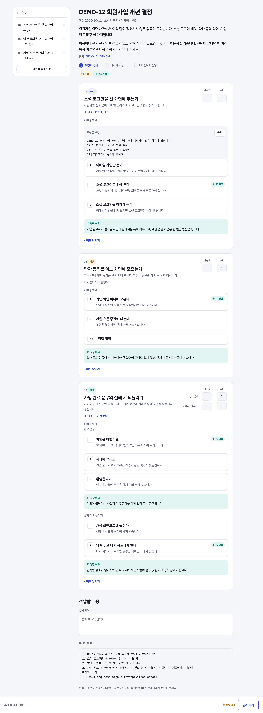
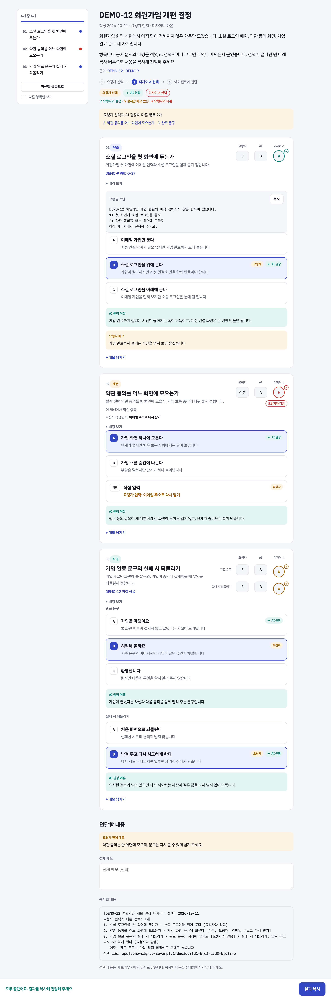
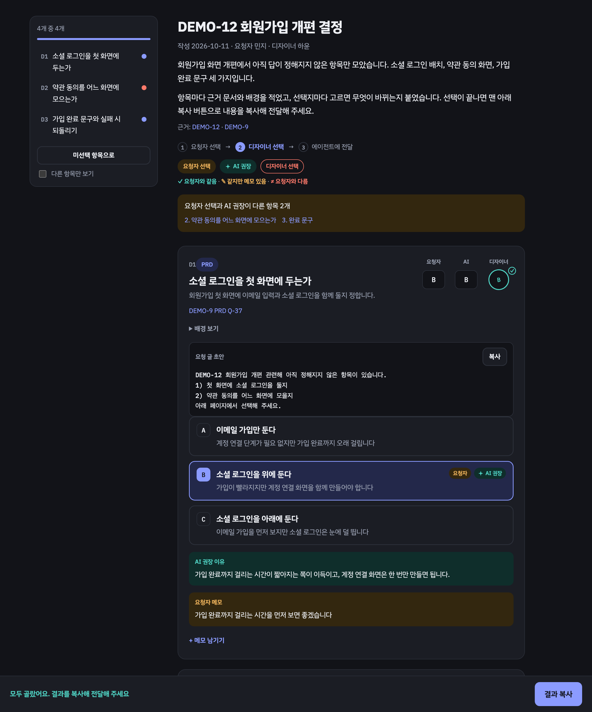
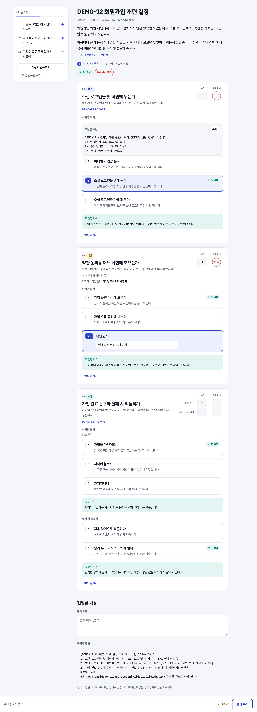

<h1 align="center"></h1>

<p align="center"><b>한국어</b> · <a href="README.en.md">English</a></p>

<p align="center"><b>회의 대신 한 장, 답장 대신 클릭</b><br><sub>비동기 의사 결정을 위한 Claude Code 스킬</sub></p>

<p align="center">
  <a href="https://github.com/lcalmsky/pickme/releases/latest"></a>
  <a href="LICENSE"></a>
  
  
</p>

<p align="center">
  <a href="#빠른-시작">빠른 시작</a> ·
  <a href="#기능">기능</a> ·
  <a href="#설치">설치</a> ·
  <a href="#사용법">사용법</a> ·
  <a href="#발행-경로">발행 경로</a> ·
  <a href="#동작-방식">동작 방식</a>
</p>

혼자 정할 수 없는 결정은 그대로 쌓입니다. 담당자의 답을 기다리는 동안 화면 작업이 멈추고, 물어보려면 결정 항목을 다시 정리해 메신저에 옮겨 적어야 합니다. pickme 는 그 결정 항목을 한 장의 HTML 페이지로 만들고, 요청자와 결정권자의 선택을 그 페이지에서 받아 결과를 에이전트에 되돌려 줍니다.

- **결정 항목과 근거를 한 페이지에 모읍니다.** 항목마다 배경, 선택지, 고르면 무엇이 바뀌는지, AI 권장과 그 이유가 붙습니다. 결정권자는 원본 문서를 다시 열지 않고 고를 수 있습니다.
- **단계가 나뉘어 있어도 같은 링크를 씁니다.** 요청자가 먼저 고르고 결정권자가 그 위에서 최종 선택을 합니다. 페이지 파일 하나와 데이터 파일 하나만 있고, 라운드 사이에 바뀌는 것은 데이터뿐이라 URL 이 바뀌지 않습니다.
- **결과는 버튼 하나나 붙여넣기 한 번으로 돌아옵니다.** 페이지가 만든 텍스트에는 선택 코드가 들어 있어, 에이전트가 그대로 파싱해 무엇이 정해졌는지 확정합니다. 요청자 단계는 로컬 서버로 열려 `요청자 확인` 버튼으로 바로 에이전트에 넘어갑니다.

<p align="center"></p>

## 빠른 시작

Claude Code 에서 플러그인을 설치합니다.

```
/plugin marketplace add lcalmsky/pickme
/plugin install pickme@pickme
```

결정이 막힌 세션에서 `/pickme:pickme` 를 입력합니다. 누구에게 물을지(역할과 이름)와 요청자가 먼저 고를지만 정하면, 에이전트가 열린 결정 항목을 모아 요청자 페이지를 로컬 서버로 엽니다. 명령 대신 "디자이너한테 물어볼 거 정리해 줘" 처럼 요청해도 됩니다.

다른 설치 방법은 [설치](#설치)에 있습니다.

## 기능

| 기능 | 내용 |
|---|---|
| [결정 페이지](#결정-페이지) | 열린 결정을 카드로 모으고, 선택지마다 고르면 무엇이 바뀌는지와 AI 권장·이유를 붙입니다 |
| [2단계 선택](#사용법) | 요청자가 먼저 고르고 결정권자가 그 위에서 최종 선택을 합니다. 요청자 단계는 건너뛸 수 있습니다 |
| [로컬 요청자 서버](#요청자-단계는-로컬로-엽니다) | 요청자 페이지를 127.0.0.1 로 열고 `요청자 확인` 버튼으로 답을 에이전트에 바로 넘깁니다 |
| [발행기 훅](#발행-경로) | 사내 공유 호스트가 있으면 발행기를 한 파일 두어 체인 맨 앞에 붙입니다 |
| [PIN 잠금](#pin-잠금) | 공유 호스트에 올리는 페이지를 4자리 PIN 으로 잠급니다 |
| [한국어·영어 페이지](#언어) | `meta.lang` 으로 화면 문구와 복사 텍스트의 언어를 고릅니다 |
| [설정](#설정) | `/pickme setup` 으로 요청자 페이지를 여는 곳과 결정권자 페이지 게시 경로를 정합니다. 게시 경로에 쓰는 스킬이나 CLI 를 말하면 에이전트가 발행기를 만들어 등록합니다 |

### 결정 페이지

결정 항목은 세 곳에서 모읍니다. 기획서나 디자인 명세의 미결 항목(`prd`·`doc`), 티켓의 미해결 항목(`jira`), 그리고 이번 세션에서 막힌 자리(`session`)입니다. 항목마다 출처와 배경, 선택지 2~4개, AI 권장과 이유가 붙고, 목록에 없는 답이 나올 수 있으면 직접 입력 칸을 둡니다.

<p align="center"></p>

오른쪽 위 결재 칸에는 요청자·AI·결정권자의 선택이 나란히 놓입니다. 결정권자 칸에는 요청자와 같으면 `✓`, 같지만 메모가 있으면 `✎`, 다르면 `≠` 가 붙어 어긋난 항목이 바로 드러납니다.

<p align="center"></p>

### 언어

`meta.lang` 을 `ko`(기본) 또는 `en` 으로 두면 화면의 모든 문구와 복사 텍스트의 언어가 정해집니다. 잠금 화면과 잠금 페이지 제목도 같은 언어를 따릅니다. 결정권자가 읽는 언어로 정하면 됩니다.

## 설치

필요한 것은 [Claude Code](https://code.claude.com) 와 `python3`(표준 라이브러리만 사용)입니다. PIN 잠금을 쓰려면 `lock.mjs` 가 도는 node(v26, 내장 `webcrypto`)도 필요합니다.

| 방법 | 호출 이름 |
|---|---|
| [플러그인](#플러그인으로-설치) (권장) | `/pickme:pickme` |
| [스킬 폴더](#스킬-폴더로-설치) | `/pickme` |
| [Orca 공유 링크](#orca-install) | `/pickme` |

### 플러그인으로 설치

```
/plugin marketplace add lcalmsky/pickme
/plugin install pickme@pickme
```

### 스킬 폴더로 설치

```bash
git clone https://github.com/lcalmsky/pickme.git
cp -r pickme/skills/pickme ~/.claude/skills/
```

### 업데이트

| 설치 방식 | 업데이트 방법 |
|---|---|
| 플러그인 | 서드파티 마켓플레이스는 자동 업데이트가 기본으로 꺼져 있습니다. `/plugin` 에서 pickme 를 골라 **Update now** 를 누르거나 `claude plugin update pickme@pickme` 를 실행합니다. 업데이트 뒤에는 `/reload-plugins` 를 실행하거나 새 세션을 시작합니다 |
| 스킬 폴더 | 클론한 저장소에서 `git pull` 한 뒤 `skills/pickme` 를 다시 복사합니다 |

<a id="orca-install"></a>

### Orca 에서 설치

[Orca](https://onorca.dev) 를 사용한다면 [공유 링크](https://share.onorca.dev/skills/share/shr_e5bf1a460177216cea40f064de523ff6504cc4b8b6422fbc) 를 열고 `Open in Orca` 를 누릅니다. Orca 에서 포함된 파일을 확인한 뒤 설치 위치를 고를 수 있습니다.

> [!NOTE]
> Orca 공유 링크는 게시할 때 올린 파일을 바꿀 수 없는 묶음으로 보관합니다. 지금 링크에는 v0.2.0 이 들어 있고, 그 뒤의 릴리즈는 반영되지 않습니다. 최신 버전은 플러그인이나 스킬 폴더 방식으로 설치합니다.

## 사용법

세 단계로 돕니다. 에이전트가 열린 결정을 모아 데이터를 쓰고, 요청자가 먼저 고르면, 결정권자가 그 위에서 최종 선택을 하고, 그 결과가 에이전트로 돌아옵니다.

| 단계 | 하는 일 |
|---|---|
| 1. 요청자 | 페이지가 로컬 서버로 열립니다. 고르고 `요청자 확인` 을 누르면 서버가 답을 받아 에이전트에 넘깁니다 |
| 2. 결정권자 | 같은 페이지가 공유 호스트나 Orca 아티팩트로 발행됩니다. 결정권자가 고르고 `결과 복사` 로 텍스트를 복사해 요청자에게 보냅니다 |
| 3. 에이전트 | 결정권자가 보낸 텍스트를 `render.py apply` 가 파싱해 무엇이 정해졌는지 확정하고, 막혀 있던 작업을 이어 갑니다 |

요청자 단계가 필요 없으면 데이터에 `skip_requester` 를 두고 결정권자 페이지로 바로 발행합니다. 결정권자의 역할은 자유롭게 정합니다 — PO, 디자이너, 개발자, QA 처럼 그 결정을 쥔 사람이면 됩니다. 역할 이름은 화면에 그대로 나오므로 팀에서 쓰는 낱말을 씁니다.

요청자 단계를 건너뛴 페이지에는 요청자 칸이 없고, 결재 칸에 AI 권장과 결정권자의 선택만 놓입니다.

<p align="center"></p>

### 설정

`/pickme setup` 은 두 가지를 정합니다. 요청자 페이지를 여는 곳은 `auto`(Orca 안이면 Orca 탭, 아니면 기본 브라우저), `orca`, `browser`, `none` 중에서 고릅니다. 게시 경로는 아무것도 정하지 않으면 기본 경로(Orca 아티팩트, 그다음 Claude 아티팩트)를 쓰고, 게시에 쓰는 스킬이나 CLI 를 말하면 에이전트가 그 문서와 `--help` 를 읽어 발행기를 만들어 등록한 뒤 시험 페이지로 한 번 돌려 봅니다. 설정을 바꾸려면 `/pickme setup` 을 다시 실행합니다.

### 요청자 단계는 로컬로 엽니다

요청자는 이 컴퓨터에 있는 사용자 자신이라 공유 호스트로 보내지 않습니다. 대신 `serve.py` 가 페이지를 127.0.0.1 로 열고, 설정에 따라 Orca 탭이나 기본 브라우저로 자동으로 열립니다. 페이지의 `요청자 확인` 버튼이 답을 그 서버로 보내고, 서버는 답을 파일로 쓰고 끝나므로 복사와 붙여넣기가 필요 없습니다. 버튼이 막히면 페이지 옆의 `결과 복사` 로 예전처럼 붙여넣어도 됩니다.

## 발행 경로

공유 페이지를 올리는 순서는 **사용자 발행기 → Orca 아티팩트 → Claude 아티팩트(로컬 파일)** 입니다. 사내 공유 호스트처럼 이 저장소가 모르는 경로는 발행기 파일 하나로 끼워 넣습니다.

발행기는 `${PICKME_PUBLISHERS_DIR:-$HOME/.config/pickme/publishers}` 안의 실행 가능한 파일입니다. 파일명 정렬 순서대로 시도하며, 디렉터리가 없거나 비면 이 단계 전체를 조용히 건너뜁니다. 각 발행기는 이렇게 호출됩니다.

```
<publisher> --name <name> --dir <상태 디렉터리> --page <page.html> --locked-page <page-locked.html> --pin <NNNN>
```

잠금 페이지를 올릴지 잠금 없는 페이지를 올릴지는 발행기가 정합니다. 사내망에서만 닿는 호스트라면 잠금 없이 올리면 됩니다. 성공은 종료 코드 0 과 stdout 마지막 줄 `delivered: <url>` 이고, PIN 을 썼으면 `delivered: <url> pin=NNNN` 입니다. 실패했을 때 마지막 줄이 `skip: <사유>` 면 그 사유가 그대로 보고됩니다. 사유에 `(run: <명령>)` 이 붙어 있으면 그 명령이 일회성 준비(로그인, VPN)를 뜻하므로, 에이전트가 그 명령을 실행해 사용자 승인을 받은 뒤 `--start publisher:<파일명>` 으로 다시 시도합니다. 로그인 자동화는 하지 않습니다.

발행기가 낸 채널은 `state.json` 에 기록되어, 다시 발행할 때 같은 발행기를 먼저 씁니다. 그래서 요청자가 이미 본 링크가 바뀌지 않습니다.

## PIN 잠금

공유 호스트에 올리는 결정권자 페이지는 4자리 PIN 으로 잠급니다. 페이지 데이터는 PBKDF2-SHA256 으로 키를 유도해 AES-GCM-256 으로 암호화되어 파일 안에 들어갑니다. PIN 을 모르면 화면에 아무 내용도 나오지 않습니다.

PIN 은 네 자리라 어깨너머로 보는 사람을 막는 정도이고, 파일을 가져가서 오프라인으로 대입하는 것까지는 막지 못합니다. 고객 개인정보나 비밀은 잠긴 페이지에도 넣지 않습니다. 발행기로 잠금 없이 올린 페이지에는 이 보호가 없습니다.

## 동작 방식

- **모델은 JSON 데이터만 씁니다.** 페이지의 생김새는 `template.html` 에 고정되어 있고, `render.py` 가 데이터를 넣어 HTML 한 장을 만듭니다. 화면을 바꾼다고 모델이 HTML 을 쓰지 않습니다. 데이터 형식의 전체 예시는 [`skills/pickme/example.json`](skills/pickme/example.json) 에 있습니다.
- **단계는 데이터 하나로 갈립니다.** `requester_picks` 가 없으면 요청자 단계, 있으면 결정권자 단계입니다. 같은 데이터 파일에 답이 쌓이므로 링크가 바뀌지 않습니다.
- **버전이 어긋난 답은 거절됩니다.** 질문이 바뀌면 `meta.version` 을 올리고, 오래된 페이지가 보낸 답은 적용하지 않습니다.
- **복사 텍스트에는 선택 코드가 들어 있습니다.** `선택 코드: apq|...` 줄이 항목별 선택을 기계가 읽을 수 있는 형태로 담고, 에이전트는 이 줄을 파싱합니다.
- **페이지는 한 파일입니다.** 데이터는 그 옆의 JSON 이고, 나머지는 브라우저가 그립니다.

## 개발

```bash
python3 -m unittest skills/pickme/test_render.py skills/pickme/test_serve.py skills/pickme/test_config.py
bash skills/pickme/test_deliver.sh
```

예시 그림 여덟 장은 Chrome 을 설치한 환경에서 다음 명령으로 다시 만듭니다. 모든 그림은 2배율, 폭 2400px 로 찍고 README 에서 `width="800"` 으로 보여 줍니다.

```bash
python3 docs/capture.py requester && python3 docs/capture.py requester --lang en   # requester.png, requester.en.png
python3 docs/capture.py decider && python3 docs/capture.py decider --lang en       # decider.png, decider.en.png
python3 docs/capture.py designer && python3 docs/capture.py designer --lang en     # designer.png, designer.en.png
python3 docs/capture.py dark && python3 docs/capture.py dark --lang en             # dark.png, dark.en.png
```

## 라이선스

[MIT](LICENSE)
